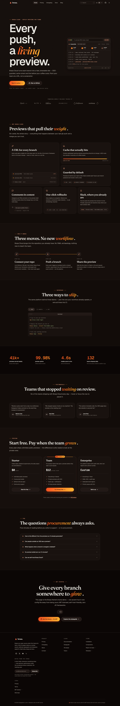
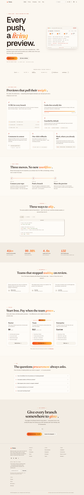
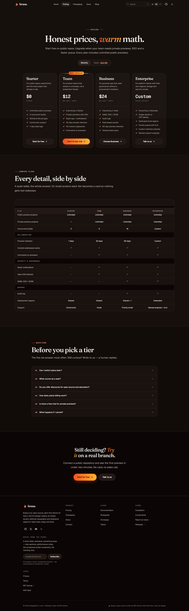
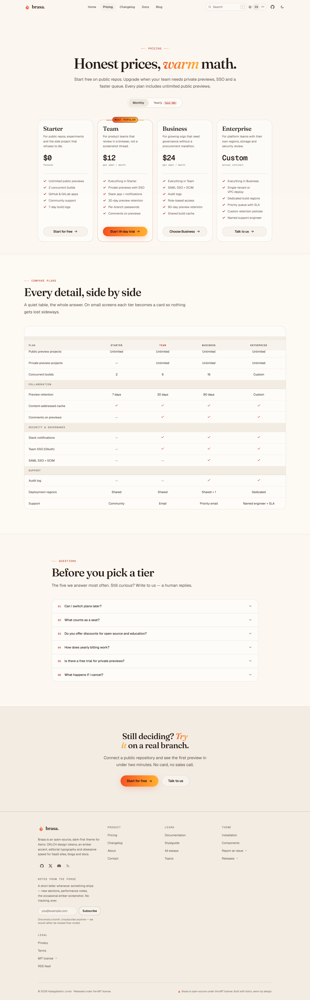
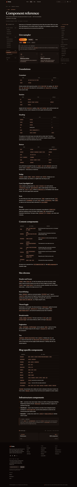
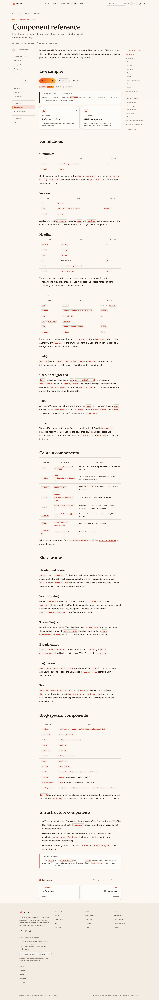

<p align="center">
  <a href="https://github.com/hadagalberto/brasa">
    
  </a>
</p>

<h1 align="center">Brasa</h1>

<p align="center"><strong>A premium, dark-first, ember-accented theme for Astro.</strong></p>

<p align="center">
  <a href="LICENSE">MIT license</a> · <a href="https://astro.build">Built with Astro</a> ·
  <a href="README.pt-BR.md">Português (Brasil)</a>
</p>

Brasa is an open-source theme for SaaS and product sites: a landing page, blog,
documentation manual, pricing, changelog and the static tooling that makes them
fast. It is warm where most themes are cold — a near-black canvas with a hint of
brown, an ember gradient from deep red-orange to amber, editorial serif display
type, and obsessive attention to speed and accessibility.

Everything is real. No lorem ipsum, no placeholder sections, no TODOs and no
broken links. The demo product is **Brasa Cloud — deploy previews for teams**,
written in English and Portuguese.

---

## What's inside

| Surface                           | What you get                                                                                                                                                                                                                                    |
| --------------------------------- | ----------------------------------------------------------------------------------------------------------------------------------------------------------------------------------------------------------------------------------------------- |
| **Home**                          | Pointer-reactive ember glow, an HTML/CSS deploy-dashboard mock, SVG wordmark cloud, a six-card spotlight bento, scroll-drawn steps, Expressive Code tabs, count-up metrics, an accessible testimonial marquee, pricing teaser and animated FAQ. |
| **Pricing**                       | Three tiers plus enterprise, a monthly/yearly toggle with no layout shift, a responsive comparison table and FAQ.                                                                                                                               |
| **Blog**                          | Featured post, grid, tags, authors, pagination, reading time, sticky table of contents, related posts, share links, RSS + JSON feeds in both locales and generated OG cards.                                                                    |
| **Docs**                          | Eleven real pages per locale documenting the theme itself, ordered/collapsible sidebar, mobile drawer, breadcrumbs, TOC, edit links and live component examples.                                                                                |
| **Changelog**                     | Timeline from a content collection with version badges and anchors.                                                                                                                                                                             |
| **About · Contact · 404 · Legal** | Full supporting pages, both locales, accessible forms and on-brand error state.                                                                                                                                                                 |
| **Search**                        | Pagefind static index with a custom command palette (`Ctrl/⌘+K` or `/`), keyboard navigation, and heading-anchored sub-results.                                                                                                                 |

### Design and engineering details

- **Dark-first OKLCH system** — semantic tokens on `:root` and `[data-theme='light']`, layered surfaces, hairlines via `color-mix()`, no pure black or white, AA/AAA contrast.
- **One hue to re-theme everything** — change `colors.accentHue` in `brasa.config.ts`; CSS tokens, syntax themes and OG images all recompute.
- **Editorial typography** — self-hosted variable Fraunces (display), Geist (text) and Geist Mono, subset to latin/latin-ext with `font-display: swap` and preloaded display faces.
- **Purposeful motion** — 150–400 ms eases, scroll-driven reveals with a visible `@supports` fallback, View Transitions with a shared-element blog-card morph, reduced-motion respected everywhere.
- **Zero UI frameworks** — interactive islands are small vanilla TypeScript modules with delegated listeners; total JS per page stays under 20 KB gzipped (asserted in tests).
- **Accessible by default** — skip link, focus-visible ember rings, focus traps in dialogs, native `<details>` accordions, labelled forms, and zero axe violations on every route in both themes.

### Visual tour

| Dark                                                                                       | Light                                                                                        |
| ------------------------------------------------------------------------------------------ | -------------------------------------------------------------------------------------------- |
|             |             |
|       |       |
|  |  |

Mobile captures (375 px) and tablet captures (768 px) for every page type live in
[`docs/screenshots/`](docs/screenshots/). Screenshots are generated with scroll
reveals pinned to their final state, so the full page is visible.

---

## Quick start

```sh
npm create astro@latest -- --template hadagalberto/brasa
cd <your-project>
npm install
npm run dev        # http://localhost:4321
```

To work on this repository directly:

```sh
git clone https://github.com/hadagalberto/brasa.git
cd brasa
npm install
npm run dev
```

Requires **Node.js 20 or newer**.

## Scripts

| Command                                   | What it does                                                                         |
| ----------------------------------------- | ------------------------------------------------------------------------------------ |
| `npm run dev`                             | Start the dev server                                                                 |
| `npm run build`                           | Verify MDX frontmatter, build to `dist/`, prepare the Pagefind index and generate it |
| `npm run preview`                         | Serve the built site locally                                                         |
| `npm run check`                           | `astro check` — TypeScript and template diagnostics                                  |
| `npm run lint`                            | ESLint (TypeScript, Astro templates, config files)                                   |
| `npm run format` / `npm run format:check` | Prettier (Astro + Tailwind class sorting, LF line endings)                           |
| `npm run test`                            | Playwright e2e + axe accessibility suite against the built site                      |
| `npm run lhci`                            | Lighthouse CI, mobile and desktop presets (≥ 0.98 in all four categories)            |
| `npm run verify:mdx`                      | Validate every MDX frontmatter block and import boundary                             |
| `npm run og`                              | Regenerate the default Open Graph image (`public/og.png`)                            |

Always build before testing: Playwright and Lighthouse serve `dist/`.

## Configuration

Everything lives in [`src/brasa.config.ts`](src/brasa.config.ts):

```ts
export const brasa: BrasaConfig = {
  site: { name: 'Brasa', github: 'https://github.com/hadagalberto/brasa' /* … */ },
  logo: { text: 'brasa' },
  nav: [/* … */],
  footer: { columns: [/* … */], socials: [/* … */], newsletter: { action: '' }, note: '…' },
  locales: { default: 'en', available: [/* en, pt-br */] },
  colors: { accentHue: 35 },
  fonts: { display: 'Fraunces Variable', sans: 'Geist Variable', mono: 'Geist Mono Variable' },
  features: { blog: true, docs: true, changelog: true, search: true },
  basePath: '/',
  contact: { action: '' },
};
```

- **Accent hue** — `colors.accentHue` drives the OKLCH ember scale, code-block themes and OG cards. `/styleguide` has a live slider to preview a value before committing.
- **Feature toggles** — `features` controls which sections appear in navigation, footer, feeds and the search dialog.
- **Base path** — `basePath` (or `PAGES_BASE_PATH`) sets the deploy base; Playwright and Lighthouse read the same value.
- **Forms** — `footer.newsletter.action` and `contact.action` (or `CONTACT_FORM_ACTION`) point at a static endpoint. Empty values keep the accessible local demo/success state.
- **Content** — `src/content/` holds blog, docs, authors and changelog collections with Zod schemas; add a file and the index, feeds, sidebar, pagination and OG image update automatically.

See [Configuration](https://hadagalberto.github.io/brasa/docs/configuration/) and
[Design tokens](https://hadagalberto.github.io/brasa/docs/design-tokens/) for the full guide.

## Deployment

The output is static (`dist/`). Every target below runs `npm ci && npm run build` and publishes `dist`.

### GitHub Pages

Set `PAGES_BASE_PATH=/<repo-name>` before building (the deploy workflow does this
automatically via repository variables). Pages uses the bundled
[`.github/workflows/deploy.yml`](.github/workflows/deploy.yml); enable
**Settings → Pages → Source: GitHub Actions**. For a custom domain, set `SITE_URL`
to your domain and leave `PAGES_BASE_PATH=/`.

### Vercel

Import the repository. Framework preset: **Astro / Other**. Build command
`npm run build`, output directory `dist`. No environment variables are needed
unless you serve from a subpath (`PAGES_BASE_PATH`).

### Netlify

New site → import from Git. Build command `npm run build`, publish directory
`dist`. Add `PAGES_BASE_PATH` only for subpath deployments.

### Cloudflare Pages

Connect the repository. Build command `npm run build`, build output `dist`.
Set `NODE_VERSION=22` and, for a subpath, `PAGES_BASE_PATH`.

## Quality gates

`npm run build`, `npm run check`, `npm run lint`, `npm run format:check`,
`npm run test` and `npm run lhci` all pass locally. CI runs the same checks on
Linux, macOS and Windows. The test suite crawls every internal link, audits every
route with axe in both themes, checks the JS budget, theme persistence without
flash, keyboard navigation, reduced motion, the pricing toggle, i18n routing,
sticky-header behaviour, search-result quality and layout invariants at
375/768/1440 px.

## Project structure

```
src/
  components/     Astro component library (zero UI frameworks)
  content/        blog, docs, authors and changelog collections (MDX + JSON)
  i18n/           English and pt-BR dictionaries
  layouts/        BaseLayout, DocsLayout
  lib/            posts, docs, feeds, OG, colour and Expressive Code helpers
  pages/          routes, feeds, OG image endpoints
  scripts/        vanilla TS islands
  styles/         global.css — OKLCH tokens, typography, motion
tests/e2e/        Playwright + axe suites
docs/screenshots/ visual reference captures
```

## Contributing

Read [CONTRIBUTING.md](CONTRIBUTING.md). In short: keep changes small, run
`npm run format && npm run check && npm run lint && npm run build && npm test`,
and never commit generated `dist/` artifacts.

## Credits

See [CREDITS.md](CREDITS.md) for the full list. In short: Fraunces, Geist and
Geist Mono via Fontsource (SIL OFL); Astro, Tailwind CSS, MDX, Expressive Code,
Pagefind (MIT); Playwright and Lighthouse CI (Apache-2.0); axe-core (MPL-2.0).

## License

MIT — see [LICENSE](LICENSE). Font files retain their original open licenses
inside `src/styles` via Fontsource. No external image hotlinks are used.
