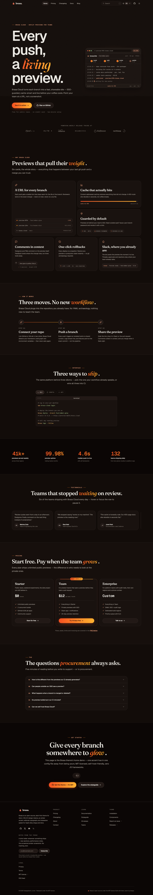
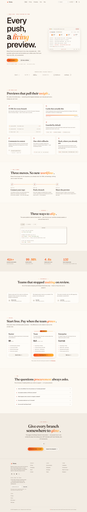
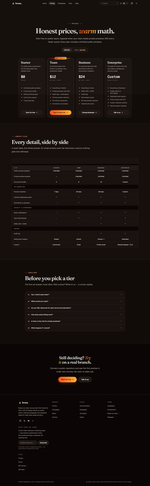
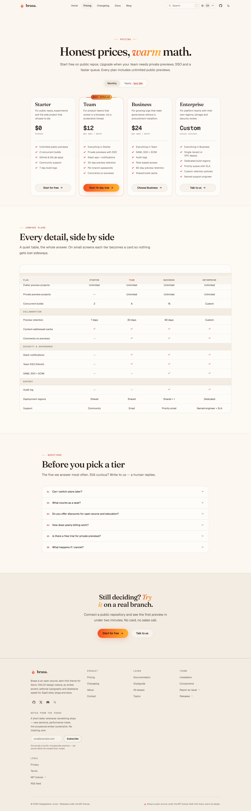
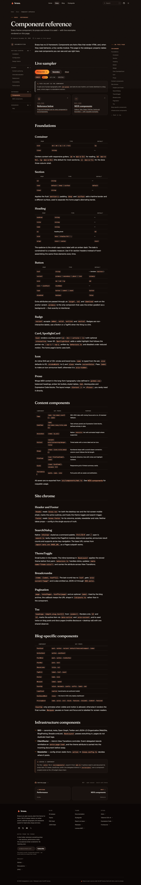
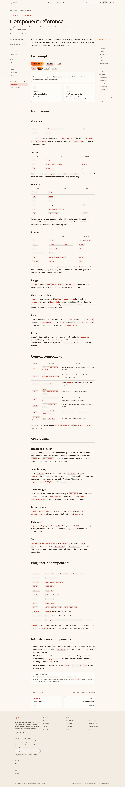

<p align="center">
  <a href="https://github.com/hadagalberto/brasa">
    
  </a>
</p>

<h1 align="center">Brasa</h1>

<p align="center"><strong>Um tema premium para Astro, com primeira opção escura e acento em brasa.</strong></p>

<p align="center">
  <a href="LICENSE">Licença MIT</a> · <a href="https://astro.build">Feito com Astro</a> ·
  <a href="README.md">English</a>
</p>

Brasa é um tema de código aberto para sites de produto e SaaS: landing page,
blog, documentação, preços, changelog e todo o ferramental estático que os torna
rápidos. É quente onde a maioria dos temas é fria — um canvas quase preto com um
toque de marrom, um gradiente em brasa do vermelho-alaranjado ao âmbar,
tipografia editorial com serifa e atenção obsessiva à velocidade e à
acessibilidade.

Tudo é real. Sem lorem ipsum, seções placeholder, TODOs ou links quebrados. O
produto de demonstração é **Brasa Cloud — prévias de deploy para times**, escrito
em inglês e português.

---

## O que vem incluído

| Superfície                        | O que você recebe                                                                                                                                                                                                                                                                                      |
| --------------------------------- | ------------------------------------------------------------------------------------------------------------------------------------------------------------------------------------------------------------------------------------------------------------------------------------------------------ |
| **Home**                          | Glow em brasa que reage ao ponteiro, mock de dashboard de deploys em HTML/CSS, nuvem de wordmarks em SVG, bento de seis cartões com spotlight, etapas desenhadas no scroll, abas de código com Expressive Code, métricas animadas, carrossel de depoimentos acessível, teaser de preços e FAQ animada. |
| **Preços**                        | Três planos mais enterprise, alternância mensal/anual sem mudança de layout, tabela comparativa responsiva e FAQ.                                                                                                                                                                                      |
| **Blog**                          | Post em destaque, grade, tags, autores, paginação, tempo de leitura, índice fixo, posts relacionados, botões de compartilhar, feeds RSS + JSON nos dois idiomas e cards OG gerados.                                                                                                                    |
| **Docs**                          | Onze páginas reais por idioma documentando o próprio tema, sidebar ordenada e recolhível, drawer mobile, breadcrumbs, TOC, links de edição e exemplos vivo de componentes.                                                                                                                             |
| **Changelog**                     | Linha do tempo a partir de uma collection, badges de versão e âncoras.                                                                                                                                                                                                                                 |
| **Sobre · Contato · 404 · Legal** | Páginas de apoio completas, nos dois idiomas, formulários acessíveis e estado de erro alinhado à marca.                                                                                                                                                                                                |
| **Busca**                         | Índice estático Pagefind com paleta de comandos (`Ctrl/⌘+K` ou `/`), navegação por teclado e resultados ancorados em títulos de seção.                                                                                                                                                                 |

### Detalhes de design e engenharia

- **Sistema OKLCH com primeira opção escura** — tokens semânticos em `:root` e `[data-theme='light']`, superfícies por luminosidade, hairlines com `color-mix()`, sem preto ou branco puros, contraste AA/AAA.
- **Um matiz para re-temar tudo** — mude `colors.accentHue` em `brasa.config.ts`; tokens CSS, temas de sintaxe e imagens OG recalculam.
- **Tipografia editorial** — Fraunces, Geist e Geist Mono variáveis auto-hospedadas via Fontsource, com `font-display: swap` e pré-carregamento.
- **Movimento com propósito** — eases de 150–400 ms, revelações por scroll com fallback visível, View Transitions com morph de card, `prefers-reduced-motion` respeitado.
- **Zero frameworks de UI** — ilhas em TypeScript puro com listeners delegados; JS total por página abaixo de 20 KB gzip (assertado em teste).
- **Acessível por padrão** — skip link, anéis de foco em brasa, focus traps, `<details>` nativo, formulários rotulados e zero violações axe em todas as rotas e temas.

### Galeria visual

| Escuro                                                                                       | Claro                                                                                        |
| -------------------------------------------------------------------------------------------- | -------------------------------------------------------------------------------------------- |
|             |             |
|        |        |
|  |  |

Capturas em 375 px (celular) e 768 px (tablet) de todos os tipos de página
estão em [`docs/screenshots/`](docs/screenshots/). As capturas fixam as
animações de revelação no estado final, mostrando a página inteira.

---

## Início rápido

```sh
npm create astro@latest -- --template hadagalberto/brasa
cd <seu-projeto>
npm install
npm run dev        # http://localhost:4321
```

Para trabalhar neste repositório diretamente:

```sh
git clone https://github.com/hadagalberto/brasa.git
cd brasa
npm install
npm run dev
```

Requer **Node.js 20 ou superior**.

## Scripts

| Comando                                   | O que faz                                                              |
| ----------------------------------------- | ---------------------------------------------------------------------- |
| `npm run dev`                             | Inicia o servidor de desenvolvimento                                   |
| `npm run build`                           | Valida frontmatter, gera `dist/`, prepara e cria o índice Pagefind     |
| `npm run preview`                         | Serve o site gerado localmente                                         |
| `npm run check`                           | `astro check` — diagnósticos de TypeScript e templates                 |
| `npm run lint`                            | ESLint                                                                 |
| `npm run format` / `npm run format:check` | Prettier (Astro + Tailwind, finais de linha LF)                        |
| `npm run test`                            | Playwright e axe contra o site gerado                                  |
| `npm run lhci`                            | Lighthouse CI, perfis mobile e desktop (≥ 0,98 em todas as categorias) |
| `npm run verify:mdx`                      | Valida frontmatter e imports de todos os arquivos MDX                  |
| `npm run og`                              | Regenera a imagem Open Graph padrão (`public/og.png`)                  |

Sempre rode o build antes dos testes: Playwright e Lighthouse servem `dist/`.

## Configuração

Tudo fica em [`src/brasa.config.ts`](src/brasa.config.ts):

```ts
export const brasa: BrasaConfig = {
  site: { name: 'Brasa', github: 'https://github.com/hadagalberto/brasa' /* … */ },
  logo: { text: 'brasa' },
  nav: [/* … */],
  footer: { columns: [/* … */], socials: [/* … */], newsletter: { action: '' }, note: '…' },
  locales: { default: 'en', available: [/* en, pt-br */] },
  colors: { accentHue: 35 },
  fonts: { display: 'Fraunces Variable', sans: 'Geist Variable', mono: 'Geist Mono Variable' },
  features: { blog: true, docs: true, changelog: true, search: true },
  basePath: '/',
  contact: { action: '' },
};
```

- **Matiz do acento** — `colors.accentHue` controla a escala OKLCH, os temas de código e as imagens OG. A rota `/styleguide` tem um slider ao vivo.
- **Toggles de recursos** — `features` controla quais seções aparecem na navegação, rodapé, feeds e diálogo de busca.
- **Caminho base** — `basePath` (ou `PAGES_BASE_PATH`) define o base de deploy; Playwright e Lighthouse usam o mesmo valor.
- **Formulários** — `footer.newsletter.action` e `contact.action` (ou `CONTACT_FORM_ACTION`) apontam para um endpoint estático. Vazios mantêm o estado local de demonstração/sucesso.
- **Conteúdo** — `src/content/` contém blog, docs, autores e changelog com schemas Zod; adicionar um arquivo atualiza índices, feeds, sidebar, paginação e imagem OG.

Veja [Configuration](https://hadagalberto.github.io/brasa/docs/configuration/) e
[Design tokens](https://hadagalberto.github.io/brasa/docs/design-tokens/).

## Deploy

A saída é estática (`dist/`). Todos os alvos abaixo executam `npm ci && npm run build` e publicam `dist`.

### GitHub Pages

Defina `PAGES_BASE_PATH=/<nome-do-repo>` antes do build (o workflow faz isso
automaticamente). O workflow incluído é
[`.github/workflows/deploy.yml`](.github/workflows/deploy.yml); ative
**Settings → Pages → Source: GitHub Actions**. Para domínio próprio, defina
`SITE_URL` e mantenha `PAGES_BASE_PATH=/`.

### Vercel

Importe o repositório. Build command `npm run build`, output `dist`. Nenhuma
variável é necessária salvo se servir de um subcaminho (`PAGES_BASE_PATH`).

### Netlify

Novo site → importar do Git. Build command `npm run build`, publish directory
`dist`. Adicione `PAGES_BASE_PATH` apenas para subcaminhos.

### Cloudflare Pages

Conecte o repositório. Build command `npm run build`, output `dist`. Defina
`NODE_VERSION=22` e, para subcaminhos, `PAGES_BASE_PATH`.

## Portões de qualidade

`npm run build`, `npm run check`, `npm run lint`, `npm run format:check`,
`npm run test` e `npm run lhci` passam localmente. A CI executa as mesmas
verificações em Linux, macOS e Windows. A suíte rastreia todos os links
internos, audita todas as rotas com axe nos dois temas, verifica o orçamento de
JS, persistência de tema sem flash, navegação por teclado, movimento reduzido,
alternância de preços, routing i18n, cabeçalho fixo, qualidade dos resultados de
busca e invariantes de layout em 375/768/1440 px.

## Estrutura

```
src/
  components/     biblioteca de componentes Astro (sem frameworks de UI)
  content/        collections blog, docs, autores e changelog (MDX + JSON)
  i18n/           dicionários inglês e pt-BR
  layouts/        BaseLayout, DocsLayout
  lib/            posts, docs, feeds, OG, cor e temas do Expressive Code
  pages/          rotas, feeds e endpoints de imagem OG
  scripts/        ilhas em TypeScript puro
  styles/         global.css — tokens OKLCH, tipografia, movimento
tests/e2e/        suítes Playwright + axe
docs/screenshots/ capturas visuais de referência
```

## Contribuindo

Leia [CONTRIBUTING.md](CONTRIBUTING.md). Resumo: mudanças pequenas, rode
`npm run format && npm run check && npm run lint && npm run build && npm test`,
e nunca commite artefatos de `dist/`.

## Créditos

Veja [CREDITS.md](CREDITS.md). Em resumo: Fraunces, Geist e Geist Mono via
Fontsource (SIL OFL); Astro, Tailwind CSS, MDX, Expressive Code e Pagefind (MIT);
Playwright e Lighthouse CI (Apache-2.0); axe-core (MPL-2.0).

## Licença

MIT — veja [LICENSE](LICENSE). Fontes mantêm suas licenças originais (SIL OFL)
em `src/styles` via Fontsource. Nenhuma imagem externa é carregada por hotlink.
